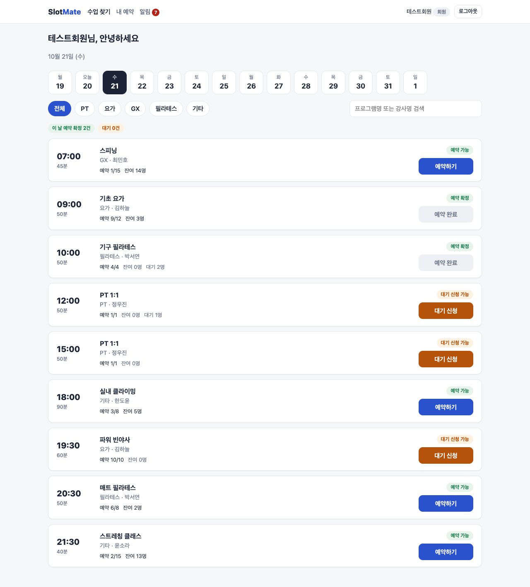
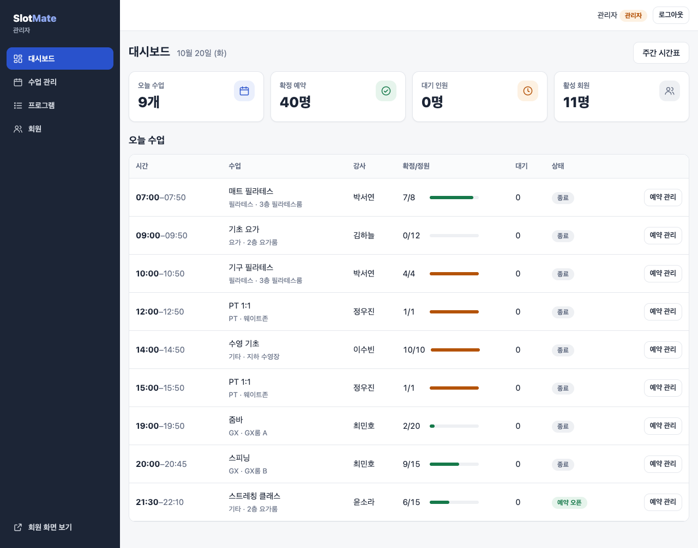
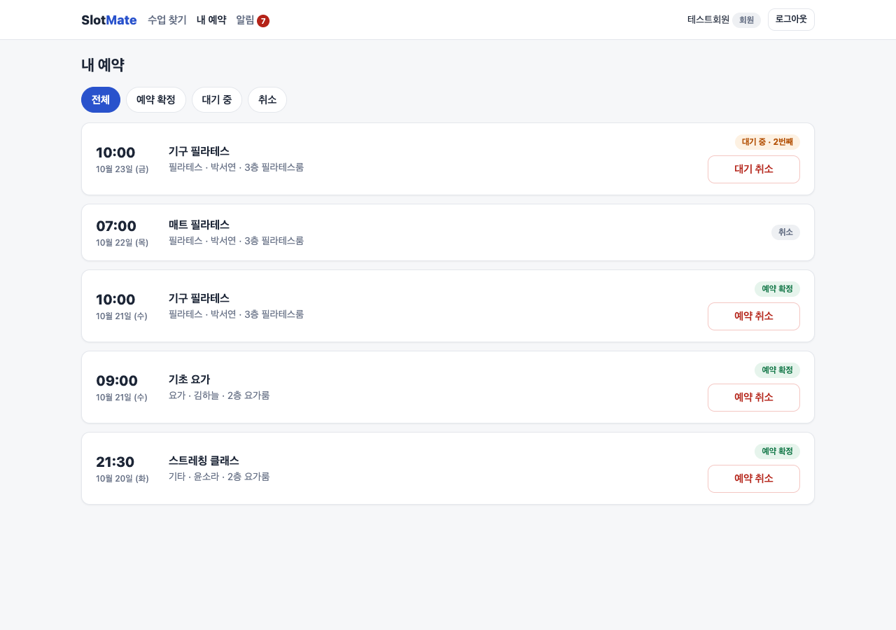
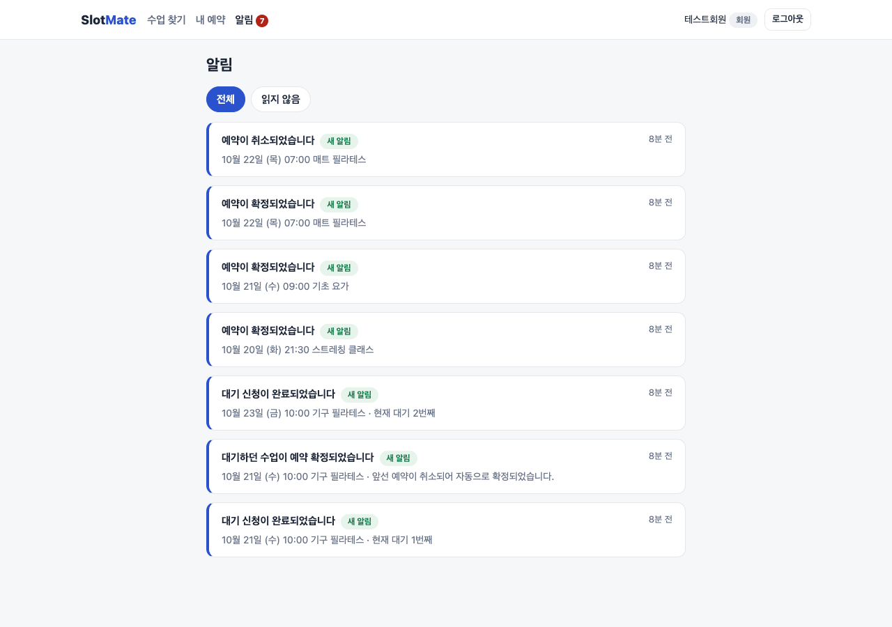
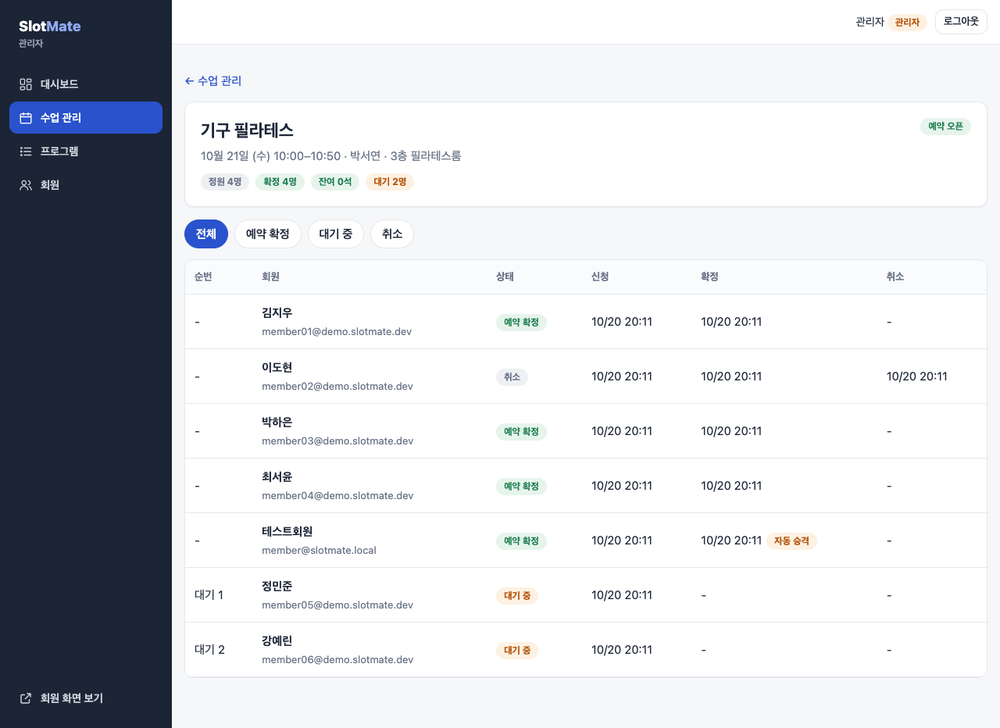
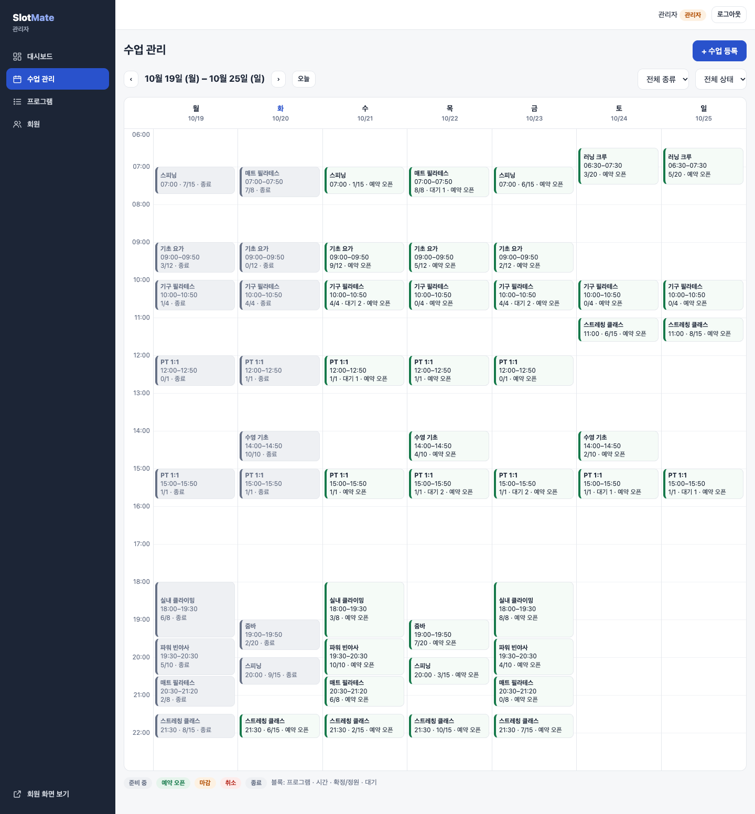
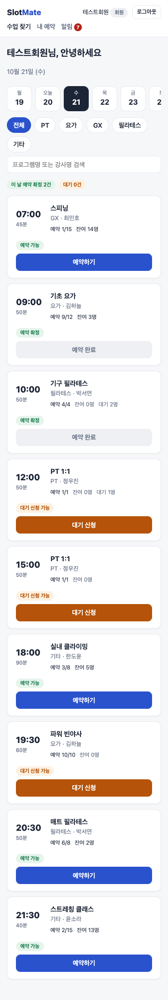

# SlotMate (가칭)

예약·대기 통합 관리 웹 서비스

> 한 줄 소개: 피트니스 센터의 PT·요가·GX 시간표를 관리하고, 예약 취소가 발생하면 대기자를 자동 승격하는 서비스.

## 프로젝트 방향

- 목표: Java/Spring 백엔드 경력직 이직을 위한 실무형 포트폴리오
- 핵심 역량: 예약 상태 관리, 트랜잭션, 동시성 제어, 데이터 정합성, 테스트, 예외 처리, SQL 성능
- 개발 방식: 요구사항 → 화면 흐름 → DB 설계 → API 설계 → 구현 → 테스트 → 배포·문서화
- 저장소 이름 제안: `slotmate`

## 1차 버전 범위

- 회원 가입 및 로그인
- 프로그램·회차 목록 조회
- 회차별 예약 및 예약 취소
- 정원 초과 시 대기 등록
- 예약 취소 시 대기 순서가 가장 빠른 회원 자동 승격
- 내 예약·대기 내역 조회
- 관리자 프로그램·회차 관리
- 인앱 알림 및 예약 상태 변경 이력

## 핵심 문제와 해결

### 1. 마지막 한 자리에 여러 명이 동시에 신청하면?

| 항목 | 내용 |
|---|---|
| 문제 | 확정 수를 세고 → 저장하는 사이에 다른 요청이 끼면 정원 초과 |
| 해결 | 예약 트랜잭션의 **첫 조회를 회차 행 잠금**(`SELECT … FOR UPDATE`)으로. 같은 회차 요청은 줄 서서 처리되고, 잠금을 얻은 뒤 확정 수를 세서 `CONFIRMED`/`WAITING` 결정 |
| 같은 회원의 중복 요청 | 잠금 안에서 활성 예약 확인 + `reservations(session_id, user_id)` UNIQUE 제약으로 이중 방어. 제약 위반은 409 로 변환 |
| 취소 → 승격 | 취소, 가장 오래 기다린 대기자 승격, 상태 이력, 알림을 **한 트랜잭션**으로. 중간 실패 시 전부 롤백 |
| 대기 순번 | 테이블에 저장하지 않고 조회 시 `(requested_at, reservation_id)` 순으로 계산 — 앞사람이 빠져도 갱신할 행이 없음 |

**다른 방법과 비교**

| 방법 | 이 서비스에서 |
|---|---|
| 낙관적 락(`@Version`) | 인기 회차에 요청이 몰리면 충돌 → 재시도가 연쇄로 일어남. 충돌이 잦은 곳이라 비관적 락이 맞음 |
| Redis 분산 락·원자 연산 | 인프라가 늘고, 최종 정합성은 결국 DB 에서 맞춰야 함. 단일 DB 규모에서는 DB 잠금으로 충분 |
| 회차 행 비관적 락 (채택) | 같은 회차 요청만 직렬화, 다른 회차는 영향 없음. 대가는 한 회차에 몰릴 때 응답 지연(아래 수치) |

### 2. 부하 테스트로 찾은 버그 — 동시 취소 시 같은 대기자만 반복 승격

k6 로 회원 200명이 정원 4명 회차에 동시 신청 → 확정자 4명이 동시 취소하자, **대기자 1명이 4번 승격되고 3자리가 빈 채로 남음**

| 항목 | 내용 |
|---|---|
| 원인 | 취소는 예약 ID 로 회차 ID 를 먼저 일반 조회한 뒤 회차를 잠금. MariaDB 기본 격리 수준(REPEATABLE READ)은 **첫 일반 조회 시점에 스냅샷을 고정**하므로, 잠금을 기다렸다 얻어도 그 뒤 일반 조회는 앞 트랜잭션이 커밋하기 전 값을 읽음 → 이미 승격된 사람을 다시 "첫 대기자"로 봄 |
| 신청은 왜 괜찮았나 | 신청은 첫 조회가 잠금 조회라 스냅샷이 잠금 **뒤**에 생김 |
| 수정 | 잠금 뒤 읽는 예약·확정 목록·첫 대기자를 잠금 조회로 → 잠금 조회는 스냅샷이 아니라 최신 커밋 값을 읽음 ([커밋](../../commit/3433d14)) |
| 재발 방지 | 실제 MariaDB 에 붙는 JUnit 동시성 테스트 추가 — 수정 전 실패(확정 1명) 확인 후 수정 |

**수정 후** ([결과 전체](loadtest/RESULTS.md))

| 회원 · 정원 | 정원 초과 | 중복 예약 | 승격 | 신청 p95 | 취소 p95 |
|---|---|---|---|---|---|
| 200 · 4 | 0 | 0 | 4/4 | 481ms | 40ms |
| 500 · 20 | 0 | 0 | 20/20 | 1.39s | 114ms |

- 신청 요청은 회원당 2개씩 동시에(따닥) 보냄. 중복은 전부 409
- 신청 p95 가 회원 수에 비례하는 것은 회차 잠금으로 줄 서기 때문 — 정합성을 우선한 대가

### 3. 테스트

- 통합 테스트 72개 — 실제 MariaDB(Docker)에 붙어 실행, 테스트마다 롤백
- 동시성 테스트 4개 — 스레드별 트랜잭션이 커밋돼야 하므로 롤백 대신 직접 정리: 마지막 한 자리 동시 신청 · 같은 회원 중복 신청 · 취소와 신청 동시 · 확정자 동시 취소
- 부하 테스트 — `./loadtest/run.sh [회원 수] [정원]` (k6)

## 화면

데모 데이터(`db/demo/seed-demo.sh`)로 찍은 화면

| 회원 — 수업 찾기 | 관리자 — 대시보드 |
|---|---|
|  |  |
| **회원 — 내 예약** | **회원 — 알림 (자동 승격 포함)** |
|  |  |
| **관리자 — 회차별 예약 (취소 → 대기 자동 승격)** | **관리자 — 주간 시간표** |
|  |  |

<details>
<summary>모바일 — 수업 찾기</summary>


</details>

## 문서

- [프로젝트 개요](docs/00_PROJECT_OVERVIEW.md)
- [요구사항 정의서 v0.1](docs/01_REQUIREMENTS_v0.1.md)
- [화면 설계서 v0.2 — 회원 목록형 + 관리자 주간 시간표](docs/02_SCREEN_DESIGN_v0.2.md)
- [화면 설계서 v0.1 (초안)](docs/02_SCREEN_DESIGN_v0.1.md)
- [UI 콘셉트 보드](docs/assets/slotmate_ui_reference_v0.2.png)
- [DB 설계서 v0.2 — 화면/API 명세 반영](docs/04_DB_DESIGN_v0.2.md)
- [DB 설계서 v0.1 (초안)](docs/04_DB_DESIGN_v0.1.md)
- [API 명세서 v0.2 — 단계 4 구현 반영](docs/05_API_SPEC_v0.2.md)
- [API 명세서 v0.1 (초안)](docs/05_API_SPEC_v0.1.md)
- [개발 단계 및 완료 기준](docs/03_ROADMAP.md)

## 기술 스택 초안

- Java 21
- Spring Boot (프로젝트 생성 시 호환되는 안정 버전 선택)
- Gradle (Groovy DSL)
- MariaDB
- Spring Web, Validation, Spring Security, Spring Data JPA
- OpenAPI/Swagger UI를 통한 API 문서화
- 테스트: JUnit 5, Spring Boot Test
- Git/GitHub, Docker는 핵심 기능 구현 이후 도입

세부 버전과 라이브러리는 프로젝트 초기화 시 공식 호환성을 확인해 확정합니다.

## 로컬 실행

필요: JDK 21, Docker Desktop

```bash
cp .env.example .env        # 값 채우기 (.env 는 git 제외)
docker compose up -d        # MariaDB 기동, 최초 1회 db/init/01_schema.sql 실행
./gradlew bootRun           # Windows: gradlew.bat bootRun
```

- 스키마를 다시 만들려면 `docker compose down -v` 로 볼륨까지 지운 뒤 다시 `up`
- 데모 데이터: 앱 실행 중 `./db/demo/seed-demo.sh` (zsh·jq 필요). 기존 회차·예약·알림은 지워짐

## 주의

이 프로젝트에는 실제 회사 코드, 회사 데이터, 비밀번호, API 키 또는 기타 비밀 정보를 넣지 않습니다.
