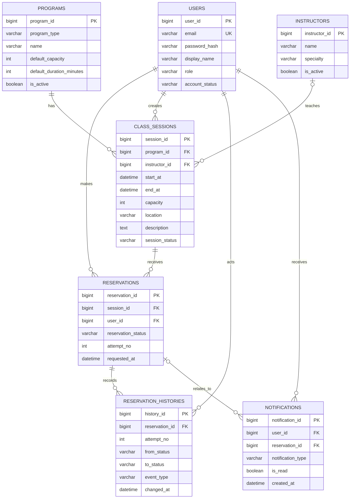

# SlotMate DB 설계서 v0.2

- 작성일: 2026-10-19
- 상태: 화면/API 명세 반영 초안 — 실제 실행 검증 전
- 프로젝트명: SlotMate (가칭)
- 서비스 범위: 피트니스 센터의 PT·요가·GX 프로그램 예약 및 대기 관리
- DBMS: MariaDB / InnoDB

## 1. 설계 목표와 가정

회원이 시간표에서 개인 PT 또는 요가·GX 수업을 선택해 예약한다. 정원이 남으면 예약을 확정하고, 정원이 차 있으면 대기자로 등록한다. 확정 예약이 취소되면 대기 순서가 가장 빠른 회원을 자동으로 승격한다.

예시 시간표:

| 프로그램 | 시작 시간 | 정원 | 예약 방식 |
|---|---:|---:|---|
| 개인 PT | 12:00 | 1명 | 1:1 예약 |
| 요가 | 13:00 | 10명 | 그룹 수업 |
| GX | 14:00 | 15명 | 그룹 수업 |

초기 범위는 단일 피트니스 센터다. 프로그램은 종류와 설명을 보관하고, 실제 날짜·시간·강사·정원은 회차 테이블에서 관리한다. 강사 로그인/급여, 이용권 결제, 다지점 운영은 1차 버전에서 제외한다.

## 2. 핵심 설계 결정

1. **프로그램과 회차를 분리한다.** `programs`는 요가·PT 같은 프로그램 정보를 저장하고, `class_sessions`는 2026-11-10 13:00 같은 실제 수업 한 건을 저장한다.
2. **정원은 회차에 둔다.** 같은 요가 프로그램도 강의실이나 시간에 따라 정원이 달라질 수 있으므로 `class_sessions.capacity`가 실제 기준이다. 프로그램의 기본 정원은 회차 생성 화면의 초기값 용도로만 사용한다.
3. **예약은 회원과 회차의 관계다.** 한 회원은 동일 회차에 한 건의 예약 레코드를 가진다. 취소 후 다시 예약하면 레코드를 재사용하고 `attempt_no`를 증가시킨다. 이전 시도와 상태 변경은 `reservation_histories`에 보존한다.
4. **대기 순번은 별도 숫자로 저장하지 않는다.** `requested_at`, `reservation_id` 순으로 계산한다. 중간 대기자가 취소해도 뒤에 있는 회원의 순번을 일괄 수정할 필요가 없다.
5. **동시 예약은 DB 트랜잭션으로 제어한다.** 예약/취소/승격 작업은 먼저 해당 회차 행을 잠그고 처리하는 방식으로 구현할 계획이다. 실제 동작은 통합 테스트로 검증한다.

## 3. ERD



## 4. 테이블 정의

### 4.1 `users` — 회원 및 관리자 계정

| 컬럼 | 타입 | 필수 | 설명 |
|---|---|---|---|
| `user_id` | BIGINT | Y | PK, 자동 증가 |
| `email` | VARCHAR(255) | Y | 로그인 이메일, 중복 불가 |
| `password_hash` | VARCHAR(255) | Y | 비밀번호 원문이 아닌 해시 |
| `display_name` | VARCHAR(80) | Y | 화면 표시 이름 |
| `role` | VARCHAR(20) | Y | `MEMBER` 또는 `ADMIN` |
| `account_status` | VARCHAR(20) | Y | `ACTIVE`, `WITHDRAWN` 등 |
| `created_at` | DATETIME(6) | Y | 생성 일시 |
| `updated_at` | DATETIME(6) | Y | 수정 일시 |

- 제약/인덱스: PK(`user_id`), UNIQUE(`email`).
- 계정은 예약 이력과 연결되므로 실제 서비스에서는 무분별하게 물리 삭제하지 않는다.

### 4.2 `programs` — 프로그램 종류/소개

| 컬럼 | 타입 | 필수 | 설명 |
|---|---|---|---|
| `program_id` | BIGINT | Y | PK, 자동 증가 |
| `program_type` | VARCHAR(20) | Y | `PT`, `YOGA`, `GX`, `PILATES`, `ETC` 등 |
| `name` | VARCHAR(100) | Y | 예: 개인 PT, 기초 요가, 파워 GX |
| `description` | TEXT | N | 회원에게 보여줄 설명 |
| `default_duration_minutes` | SMALLINT | Y | 회차 생성 시 기본 수업 시간(분) |
| `default_capacity` | INT | Y | 회차 생성 시 기본 정원. 실제 정원과 다를 수 있음 |
| `is_active` | TINYINT(1) | Y | 신규 예약 대상으로 노출할지 여부 |
| `created_at` | DATETIME(6) | Y | 생성 일시 |
| `updated_at` | DATETIME(6) | Y | 수정 일시 |

- 제약/인덱스: PK(`program_id`), INDEX(`is_active`, `program_type`).
- 프로그램을 비활성화해도 기존 회차·예약 이력은 삭제하지 않는다.

### 4.3 `instructors` — 강사/트레이너 정보

| 컬럼 | 타입 | 필수 | 설명 |
|---|---|---|---|
| `instructor_id` | BIGINT | Y | PK, 자동 증가 |
| `name` | VARCHAR(80) | Y | 강사/트레이너 이름 |
| `specialty` | VARCHAR(100) | N | 예: 퍼스널 트레이닝, 요가 |
| `is_active` | TINYINT(1) | Y | 배정 가능한 강사인지 여부 |
| `created_at` | DATETIME(6) | Y | 생성 일시 |

- 강사 전용 로그인은 1차 버전에 포함하지 않는다. 강사별 로그인/개인 시간표가 필요해지면 `users`와 연결하는 방향으로 확장한다.

### 4.4 `class_sessions` — 실제 날짜·시간별 수업 회차

| 컬럼 | 타입 | 필수 | 설명 |
|---|---|---|---|
| `session_id` | BIGINT | Y | PK, 자동 증가 |
| `program_id` | BIGINT | Y | FK → `programs.program_id` |
| `instructor_id` | BIGINT | N | FK → `instructors.instructor_id`; 미지정 가능 |
| `start_at` | DATETIME(6) | Y | 수업 시작 시각 |
| `end_at` | DATETIME(6) | Y | 수업 종료 시각 |
| `capacity` | INT | Y | 해당 회차의 확정 예약 정원. 1 이상 |
| `location` | VARCHAR(150) | N | 수업 장소(예: 2층 GX룸) |
| `description` | TEXT | N | 회차별 유의사항이나 추가 안내 |
| `session_status` | VARCHAR(20) | Y | `DRAFT`, `OPEN`, `CLOSED`, `CANCELLED`, `COMPLETED` |
| `created_by_user_id` | BIGINT | Y | FK → `users.user_id`, 회차를 등록한 관리자 |
| `created_at` | DATETIME(6) | Y | 생성 일시 |
| `updated_at` | DATETIME(6) | Y | 수정 일시 |

- 제약/인덱스: PK(`session_id`), INDEX(`program_id`, `start_at`), INDEX(`session_status`, `start_at`), INDEX(`instructor_id`, `start_at`).
- `start_at < end_at`, `capacity >= 1`은 API 검증과 서비스 계층에서 확인한다.
- 예약 수용 여부는 `session_status = 'OPEN'`인지, 시작 시각이 미래인지, 정원이 남았는지 함께 판단한다.
- 1:1 PT 회차는 보통 `capacity = 1`, 그룹 요가/GX는 예를 들어 `capacity = 10` 또는 `15`로 생성한다.

### 4.5 `reservations` — 회원별 회차 예약의 현재 상태

| 컬럼 | 타입 | 필수 | 설명 |
|---|---|---|---|
| `reservation_id` | BIGINT | Y | PK, 자동 증가 |
| `session_id` | BIGINT | Y | FK → `class_sessions.session_id` |
| `user_id` | BIGINT | Y | FK → `users.user_id` |
| `reservation_status` | VARCHAR(20) | Y | `CONFIRMED`, `WAITING`, `CANCELLED` |
| `attempt_no` | INT | Y | 같은 회원이 취소 후 재예약한 횟수를 구분하기 위한 시도 번호(최초 1) |
| `requested_at` | DATETIME(6) | Y | 현재 예약 시도의 신청 시각. 재예약 시 갱신 |
| `confirmed_at` | DATETIME(6) | N | 현재 시도가 확정된 시각 |
| `cancelled_at` | DATETIME(6) | N | 현재 시도가 취소된 시각 |
| `created_at` | DATETIME(6) | Y | 레코드 최초 생성 시각 |
| `updated_at` | DATETIME(6) | Y | 마지막 변경 시각 |

- 제약/인덱스: PK(`reservation_id`), UNIQUE(`session_id`, `user_id`), INDEX(`session_id`, `reservation_status`, `requested_at`, `reservation_id`), INDEX(`user_id`, `reservation_status`, `requested_at`).
- UNIQUE 제약으로 동일 회원·회차 조합의 현재 예약 레코드는 하나만 유지한다. 취소 후 재예약 시 레코드를 새로 추가하지 않고 상태와 `attempt_no`를 갱신하며, 과거 변경은 이력 테이블에서 조회한다.
- 대기 순서는 `reservation_status = 'WAITING'`인 행을 `requested_at`, `reservation_id` 오름차순으로 정렬해 계산한다.

### 4.6 `reservation_histories` — 예약 상태 변경 이력

| 컬럼 | 타입 | 필수 | 설명 |
|---|---|---|---|
| `history_id` | BIGINT | Y | PK, 자동 증가 |
| `reservation_id` | BIGINT | Y | FK → `reservations.reservation_id` |
| `attempt_no` | INT | Y | 어느 예약 시도에 해당하는 이력인지 구분 |
| `from_status` | VARCHAR(20) | N | 변경 전 상태. 최초 생성 이벤트는 NULL |
| `to_status` | VARCHAR(20) | Y | 변경 후 상태 |
| `event_type` | VARCHAR(30) | Y | 예: `BOOKED`, `WAITLISTED`, `CANCELLED`, `PROMOTED`, `REBOOKED` |
| `actor_user_id` | BIGINT | N | 회원 또는 관리자가 직접 변경했으면 해당 사용자 ID, 자동 처리면 NULL 가능 |
| `memo` | VARCHAR(500) | N | 내부 설명/처리 사유. 민감 정보는 기록하지 않음 |
| `changed_at` | DATETIME(6) | Y | 상태가 변경된 시각 |

- 제약/인덱스: PK(`history_id`), INDEX(`reservation_id`, `changed_at`), INDEX(`event_type`, `changed_at`).
- 예약 상태를 변경할 때 상태 변경과 이력 추가를 같은 트랜잭션으로 처리한다.

### 4.7 `notifications` — 인앱 알림

| 컬럼 | 타입 | 필수 | 설명 |
|---|---|---|---|
| `notification_id` | BIGINT | Y | PK, 자동 증가 |
| `user_id` | BIGINT | Y | FK → `users.user_id`, 알림 수신자 |
| `reservation_id` | BIGINT | N | FK → `reservations.reservation_id`, 관련 예약(선택) |
| `notification_type` | VARCHAR(30) | Y | 예: `BOOKING_CONFIRMED`, `WAITLISTED`, `PROMOTED`, `CANCELLED` |
| `title` | VARCHAR(150) | Y | 알림 제목 |
| `message` | VARCHAR(500) | Y | 알림 본문 |
| `is_read` | TINYINT(1) | Y | 읽음 여부, 기본값 0 |
| `created_at` | DATETIME(6) | Y | 생성 시각 |
| `read_at` | DATETIME(6) | N | 읽은 시각 |

- 제약/인덱스: PK(`notification_id`), INDEX(`user_id`, `is_read`, `created_at`).
- 1차 버전은 웹 안에서 보는 인앱 알림만 구현한다. 문자·이메일·카카오 알림톡은 제외한다.

## 5. MariaDB DDL 초안

아래 DDL은 구조를 이해하기 위한 초기안이다. 실제 실행 전 프로젝트에서 선택한 MariaDB 버전으로 생성 테스트를 하고, 컬럼·제약을 최종 확정한다.

```sql
CREATE TABLE users (
    user_id BIGINT NOT NULL AUTO_INCREMENT,
    email VARCHAR(255) NOT NULL,
    password_hash VARCHAR(255) NOT NULL,
    display_name VARCHAR(80) NOT NULL,
    role VARCHAR(20) NOT NULL DEFAULT 'MEMBER',
    account_status VARCHAR(20) NOT NULL DEFAULT 'ACTIVE',
    created_at DATETIME(6) NOT NULL DEFAULT CURRENT_TIMESTAMP(6),
    updated_at DATETIME(6) NOT NULL DEFAULT CURRENT_TIMESTAMP(6)
        ON UPDATE CURRENT_TIMESTAMP(6),
    PRIMARY KEY (user_id),
    UNIQUE KEY uq_users_email (email)
) ENGINE=InnoDB DEFAULT CHARSET=utf8mb4 COLLATE=utf8mb4_unicode_ci;

CREATE TABLE programs (
    program_id BIGINT NOT NULL AUTO_INCREMENT,
    program_type VARCHAR(20) NOT NULL,
    name VARCHAR(100) NOT NULL,
    description TEXT NULL,
    default_duration_minutes SMALLINT NOT NULL,
    default_capacity INT NOT NULL,
    is_active TINYINT(1) NOT NULL DEFAULT 1,
    created_at DATETIME(6) NOT NULL DEFAULT CURRENT_TIMESTAMP(6),
    updated_at DATETIME(6) NOT NULL DEFAULT CURRENT_TIMESTAMP(6)
        ON UPDATE CURRENT_TIMESTAMP(6),
    PRIMARY KEY (program_id),
    KEY ix_programs_active_type (is_active, program_type)
) ENGINE=InnoDB DEFAULT CHARSET=utf8mb4 COLLATE=utf8mb4_unicode_ci;

CREATE TABLE instructors (
    instructor_id BIGINT NOT NULL AUTO_INCREMENT,
    name VARCHAR(80) NOT NULL,
    specialty VARCHAR(100) NULL,
    is_active TINYINT(1) NOT NULL DEFAULT 1,
    created_at DATETIME(6) NOT NULL DEFAULT CURRENT_TIMESTAMP(6),
    PRIMARY KEY (instructor_id)
) ENGINE=InnoDB DEFAULT CHARSET=utf8mb4 COLLATE=utf8mb4_unicode_ci;

CREATE TABLE class_sessions (
    session_id BIGINT NOT NULL AUTO_INCREMENT,
    program_id BIGINT NOT NULL,
    instructor_id BIGINT NULL,
    start_at DATETIME(6) NOT NULL,
    end_at DATETIME(6) NOT NULL,
    capacity INT NOT NULL,
    location VARCHAR(150) NULL,
    description TEXT NULL,
    session_status VARCHAR(20) NOT NULL DEFAULT 'DRAFT',
    created_by_user_id BIGINT NOT NULL,
    created_at DATETIME(6) NOT NULL DEFAULT CURRENT_TIMESTAMP(6),
    updated_at DATETIME(6) NOT NULL DEFAULT CURRENT_TIMESTAMP(6)
        ON UPDATE CURRENT_TIMESTAMP(6),
    PRIMARY KEY (session_id),
    KEY ix_sessions_program_start (program_id, start_at),
    KEY ix_sessions_status_start (session_status, start_at),
    KEY ix_sessions_instructor_start (instructor_id, start_at),
    KEY ix_sessions_start (start_at),
    CONSTRAINT fk_sessions_program FOREIGN KEY (program_id)
        REFERENCES programs (program_id),
    CONSTRAINT fk_sessions_instructor FOREIGN KEY (instructor_id)
        REFERENCES instructors (instructor_id),
    CONSTRAINT fk_sessions_creator FOREIGN KEY (created_by_user_id)
        REFERENCES users (user_id)
) ENGINE=InnoDB DEFAULT CHARSET=utf8mb4 COLLATE=utf8mb4_unicode_ci;

CREATE TABLE reservations (
    reservation_id BIGINT NOT NULL AUTO_INCREMENT,
    session_id BIGINT NOT NULL,
    user_id BIGINT NOT NULL,
    reservation_status VARCHAR(20) NOT NULL,
    attempt_no INT NOT NULL DEFAULT 1,
    requested_at DATETIME(6) NOT NULL DEFAULT CURRENT_TIMESTAMP(6),
    confirmed_at DATETIME(6) NULL,
    cancelled_at DATETIME(6) NULL,
    created_at DATETIME(6) NOT NULL DEFAULT CURRENT_TIMESTAMP(6),
    updated_at DATETIME(6) NOT NULL DEFAULT CURRENT_TIMESTAMP(6)
        ON UPDATE CURRENT_TIMESTAMP(6),
    PRIMARY KEY (reservation_id),
    UNIQUE KEY uq_reservations_session_user (session_id, user_id),
    KEY ix_reservations_session_queue
        (session_id, reservation_status, requested_at, reservation_id),
    KEY ix_reservations_user_status
        (user_id, reservation_status, requested_at),
    CONSTRAINT fk_reservations_session FOREIGN KEY (session_id)
        REFERENCES class_sessions (session_id),
    CONSTRAINT fk_reservations_user FOREIGN KEY (user_id)
        REFERENCES users (user_id)
) ENGINE=InnoDB DEFAULT CHARSET=utf8mb4 COLLATE=utf8mb4_unicode_ci;

CREATE TABLE reservation_histories (
    history_id BIGINT NOT NULL AUTO_INCREMENT,
    reservation_id BIGINT NOT NULL,
    attempt_no INT NOT NULL,
    from_status VARCHAR(20) NULL,
    to_status VARCHAR(20) NOT NULL,
    event_type VARCHAR(30) NOT NULL,
    actor_user_id BIGINT NULL,
    memo VARCHAR(500) NULL,
    changed_at DATETIME(6) NOT NULL DEFAULT CURRENT_TIMESTAMP(6),
    PRIMARY KEY (history_id),
    KEY ix_history_reservation_changed (reservation_id, changed_at),
    KEY ix_history_event_changed (event_type, changed_at),
    CONSTRAINT fk_history_reservation FOREIGN KEY (reservation_id)
        REFERENCES reservations (reservation_id),
    CONSTRAINT fk_history_actor FOREIGN KEY (actor_user_id)
        REFERENCES users (user_id)
) ENGINE=InnoDB DEFAULT CHARSET=utf8mb4 COLLATE=utf8mb4_unicode_ci;

CREATE TABLE notifications (
    notification_id BIGINT NOT NULL AUTO_INCREMENT,
    user_id BIGINT NOT NULL,
    reservation_id BIGINT NULL,
    notification_type VARCHAR(30) NOT NULL,
    title VARCHAR(150) NOT NULL,
    message VARCHAR(500) NOT NULL,
    is_read TINYINT(1) NOT NULL DEFAULT 0,
    created_at DATETIME(6) NOT NULL DEFAULT CURRENT_TIMESTAMP(6),
    read_at DATETIME(6) NULL,
    PRIMARY KEY (notification_id),
    KEY ix_notifications_user_read_created (user_id, is_read, created_at),
    CONSTRAINT fk_notifications_user FOREIGN KEY (user_id)
        REFERENCES users (user_id),
    CONSTRAINT fk_notifications_reservation FOREIGN KEY (reservation_id)
        REFERENCES reservations (reservation_id)
) ENGINE=InnoDB DEFAULT CHARSET=utf8mb4 COLLATE=utf8mb4_unicode_ci;
```

## 6. 예약 및 대기 처리 규칙

### 6.1 예약 신청

1. 트랜잭션 시작 후 해당 `class_sessions` 행을 잠근다.
2. 회차 상태가 `OPEN`이고 시작 시간이 아직 지나지 않았는지 확인한다.
3. 같은 회원의 해당 회차 예약을 조회한다. `CONFIRMED` 또는 `WAITING`이면 중복 신청을 거절한다.
4. `CONFIRMED` 예약 수가 `capacity`보다 작으면 `CONFIRMED`, 아니면 `WAITING`으로 저장한다.
5. 예약 상태 이력을 저장한다. 필요한 경우 회원에게 인앱 알림을 생성한다.
6. 모두 성공하면 커밋한다. 중간에 실패하면 롤백한다.

### 6.2 예약 취소 및 자동 승격

1. 트랜잭션 안에서 해당 회차 행을 먼저 잠근다.
2. 예약 소유자, 현재 상태, 취소 가능 여부를 검증한다.
3. 본 예약을 `CANCELLED`로 변경하고 이력을 기록한다.
4. 회차가 `OPEN`이고 시작 전이라면 대기 예약 중 `requested_at`, `reservation_id`가 가장 빠른 한 건을 선택한다.
5. 선택된 대기 예약을 `CONFIRMED`로 변경하고 이력 및 인앱 알림을 생성한다.
6. 본 예약 취소와 대기자 승격을 한 트랜잭션으로 커밋한다.

### 6.3 마지막 한 자리 동시 요청 방지

같은 회차의 예약 요청이 동시에 들어와도 각 요청이 먼저 같은 회차 행 잠금을 얻도록 설계한다. 잠금을 얻은 요청이 정원 확인과 예약 변경을 끝낸 후 다음 요청이 처리되므로, 구현이 일관되다면 확정 인원이 정원을 넘지 않게 할 수 있다. 이 전제는 단위 테스트만으로 충분하지 않으므로 실제 MariaDB를 사용하는 통합 테스트에서 동시 요청을 검증한다.

## 7. 대기 순번 계산 예시

한 회차에서 다음 대기 예약이 있다고 가정한다.

| 회원 | `requested_at` | `reservation_id` | 대기 순번 |
|---|---|---:|---:|
| 회원 A | 12:01:00 | 101 | 1 |
| 회원 B | 12:02:00 | 102 | 2 |
| 회원 C | 12:02:00 | 103 | 3 |

회원 B가 대기를 취소하면 회원 C의 순번은 별도로 수정하지 않아도 2가 된다. 화면을 조회할 때 현재 `WAITING` 상태인 예약을 정렬해 순번을 계산한다.

## 8. 주요 인덱스의 목적

| 인덱스 | 목적 |
|---|---|
| `users(email)` UNIQUE | 이메일 중복 방지 및 로그인 조회 |
| `class_sessions(program_id, start_at)` | 프로그램별 예정 회차 조회 |
| `class_sessions(session_status, start_at)` | 예약 오픈 회차/오늘의 회차 조회 |
| `class_sessions(start_at)` | 날짜 범위 회차 조회(회원 날짜별 목록·관리자 주간 시간표). 2026-10-20 추가 — 위 인덱스는 `status <> 'DRAFT'`·상태 조건 없음일 때 날짜 범위로 못 좁힘 (`loadtest/perf/RESULTS.md`) |
| `reservations(session_id, user_id)` UNIQUE | 동일 회원의 동일 회차 중복 예약 방지 |
| `reservations(session_id, reservation_status, requested_at, reservation_id)` | 확정 인원 집계와 대기 순서 조회 지원 |
| `reservations(user_id, reservation_status, requested_at)` | 내 예약 목록 조회 |
| `reservation_histories(reservation_id, changed_at)` | 예약별 상태 변경 이력 조회 |
| `notifications(user_id, is_read, created_at)` | 회원별 읽지 않은 알림 및 최신 알림 조회 |

인덱스는 조회 패턴을 바탕으로 우선 설계한 초안이다. 구현 후 `EXPLAIN`과 실제 데이터로 확인하고 필요 없는 인덱스는 정리한다.

## 9. 구현 시 주의 사항

- 예약 상태·회차 상태는 문자열 컬럼에 임의 값을 넣지 않고 Java enum 및 요청 검증으로 제한한다.
- 예약/취소/승격을 서로 다른 독립 트랜잭션으로 처리하지 않는다.
- 물리 삭제보다는 비활성 상태와 이력 보존을 우선한다.
- 대기 순번을 테이블에 고정 숫자로 저장하지 않는다.
- 클라이언트가 전달한 잔여석 숫자를 신뢰하지 않는다. 서버가 DB에서 다시 확인한다.
- 날짜/시간 처리 기준을 개발 환경 전체에서 통일한다. 한국 서비스 초기 버전에서는 `Asia/Seoul` 기준으로 처리하고, 테스트도 같은 기준을 사용한다.
- 강사 시간이 겹치는 회차 생성 방지, 예약 변경, 노쇼 처리, 이용권 횟수 차감은 추가 요구사항을 확정한 후 확장한다.

## 10. 다음 설계 단계

DB 설계를 검토한 뒤 REST API 명세서를 만든다. API별로 어떤 테이블을 읽고 변경하는지, 성공 응답과 주요 오류 응답을 요구사항 ID에 연결한다. 그다음 ERD와 DDL을 실제 MariaDB에서 생성해 검증한다.


## 12. v0.2 변경 이력

- 화면/API 명세에서 사용하기로 한 회차별 `location`, `description` 컬럼을 `class_sessions`에 추가했다.
- 본 문서의 DDL은 설계 초안이며, MariaDB 실제 실행 및 제약 조건 검증은 DB 구현 단계에서 수행한다.
